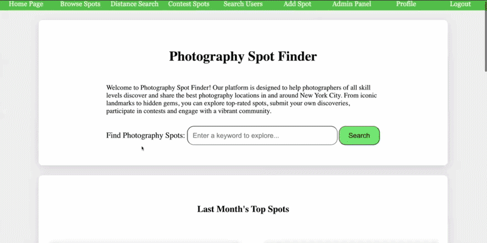
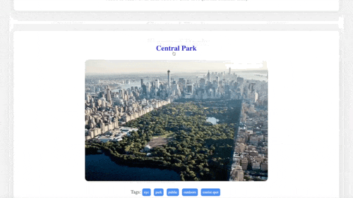
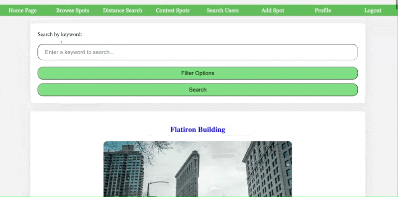
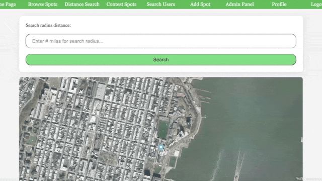
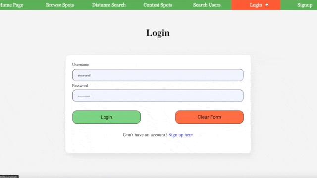
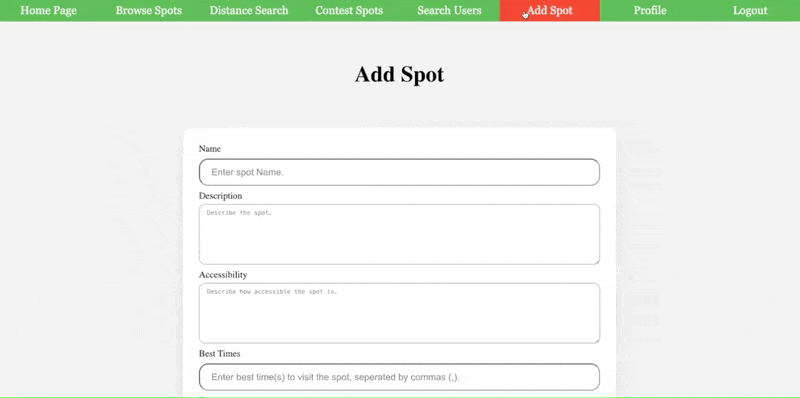
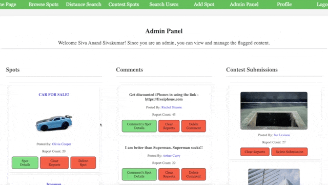
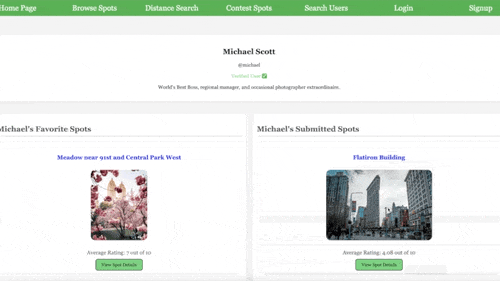
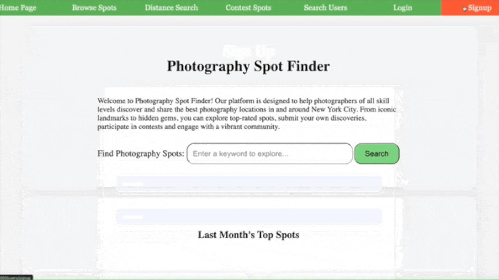
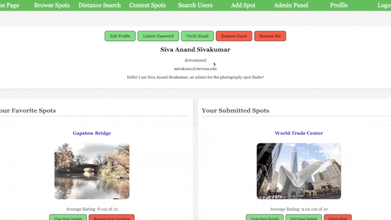

# Photography Spot Finder - NYC

Discover, share, and explore the best photography locations in New York City! Photography Spot Finder is a full-stack web application for photographers to find, rate, and contribute top photo spots, with robust geospatial search, image management, and community features.

---

## Table of Contents

- [Demo Preview](#demo-preview)
- [Features](#features)
- [Tech Stack](#tech-stack)
- [Setup & Local Development](#setup--local-development)
- [Testing & CI](#testing--ci)
- [Seeding & Exporting Data](#seeding--exporting-data)
- [Github link](#github-link)

---

## Demo Preview


### Landing Page
<p align="center">
   
</p>

### Spot Details
<p align="center">
   
</p>

### Spots Search
<p align="center">
   
</p>

### Geospatial Search
<p align="center">
   
</p>

### Contest Page
<p align="center">
   
</p>

### Spot Submission
<p align="center">
   
</p>

### Admin Panel
<p align="center">
   
</p>

### User Profile
<p align="center">
   
</p>

### Public User Profile
<p align="center">
   
</p>

### User Signup
<p align="center">
   
</p>

### User Verification
<p align="center">
   
</p>

---


## Features

### User Features
- **Geospatial Search:** Find spots near your location using interactive Mapbox maps and MongoDB geospatial queries.
- **Image Uploads:** Upload and manage spot images with Cloudinary. Images are automatically deleted from the cloud when assets are removed.
- **Spot Submission:** Add new spots with location, description, accessibility, best times, images, and tags.
- **Ratings & Favorites:** Rate spots (1-10), add comments, and save favorite locations.
- **Monthly Photo Contest:** Submit photos to monthly contests, vote on entries, and view contest leaders. AJAX-powered for seamless UX.
- **User Profiles:** Edit your profile, view your activity, and manage your favorite spots.
- **Search & Filter:** Search by keyword, tag, or distance. Filter results for easy discovery.
- **Email Verification:** Secure sign-up and email verification via OTP.
- **Public Profiles:** View other users’ public profiles, including their spots, comments, and contest entries.

### Admin & Moderation
- **Reporting:** Report inappropriate spots, comments, or contest entries. Admins can review and moderate flagged content.
- **Admin Panel:** Manage reported content, clear reports, and remove problematic assets.

### Engineering & Security
- **Security:**
   - XSS sanitization on all user input (xss package)
   - Passwords hashed with bcrypt
   - Session management with express-session
   - Email/OTP verification for account security
- **Validation:** Strong input validation for all user data, including custom password and username policies.
- **Database Seeding & Export:** Seed the database with test data and export/import DB state for testing.
- **Testing & CI:** Jest for unit tests, GitHub Actions for CI/CD, with database reset and reseed on test runs.
- **Logging:** Centralized logging for audit and debugging.

---

## Tech Stack

<p>
   
   
   
   
   
   
   
   
</p>

- Backend: Node.js, Express.js
- Database: MongoDB (native driver)
- Frontend: Handlebars, JavaScript (ES6+), CSS3
- APIs: Mapbox (maps/geocoding), Cloudinary (image hosting), Nodemailer (email)
- DevOps: Jest (unit testing), GitHub Actions (CI/CD)
- Security: bcrypt, express-session, xss, dotenv


---

## Setup & Local Development


### 1. Clone & Install
```bash
git clone https://github.com/sivaanand13/photography-spot-finder.git
cd photography-spot-finder
npm install
```

### 2. Seed the Database
```bash
npm run seed
```

### 3. Configure Environment
Create a `.env` file in the root directory:
```
MAPBOX_API_TOKEN="api-key-here"
CLOUDINARY_API_KEY="api-key-here"
CLOUDINARY_API_SECRET="secret-here"
EMAIL_USER="email-here"
EMAIL_PASS="email-app-password-here"
```

### 4. Start the Application
```bash
npm start
```
The app will run on [http://localhost:3000](http://localhost:3000)

**Note:**
- Deleting an asset with an image will also delete the image from Cloudinary.
- If you reseed after deleting assets, images may not appear unless you re-add them and export the DB state.
- Use `npm run export` to export your current DB state.

**Admin credentials for demo:**
- username: sivaanand
- password: Password@1234


---

## Testing & CI
- Run all unit tests:
```bash
npm run test
```
This will empty the database, run tests, and reseed the database. All tests are run automatically on every pull request via GitHub Actions.

---

## Seeding & Exporting Data
- `npm run seed` — Seed the database with demo/test data
- `npm run export` — Export the current database state


## Github link

[https://github.com/sivaanand13/photography-spot-finder](https://github.com/sivaanand13/photography-spot-finder)

## Unit testing

We conducted unit testing using jest and have used a github workflow to create CI pipeline. You can run the tests using the command `npm run test`. This will empty the database, run the tests and then reseed the database.
